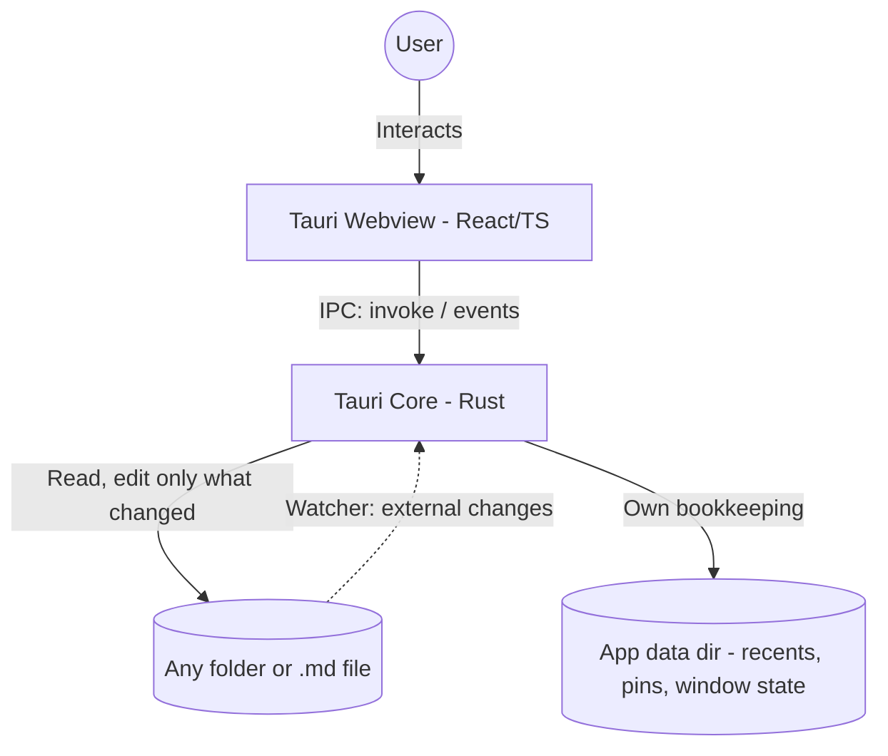

# Architecture Overview

Glade is a cross-platform desktop application built with **Tauri v2**. It is a viewer and editor for markdown files that already exist on disk: the user's files are the source of truth, and Glade stores only its own bookkeeping elsewhere.

## High-Level Diagram

## Principles

- **Files stand on their own.** Glade never writes into a user's folder except the `.md` files being edited. No `.glade` marker directories, no ids or timestamps injected into frontmatter.
- **Edit, don't rewrite.** Saving writes only what changed: frontmatter edits replace just the lines of one key; untouched body blocks are written back as their original text; a save that changes nothing writes nothing.
- **Folders, not vaults.** Any folder can be opened; "pinned" only controls what Home lists. Every opened folder gets the same features.

## Backend (Rust, `src-tauri/src`)

| Module | Responsibility |
|---|---|
| `workspace.rs` | What each window shows (a folder, a loose file, or Home). Commands resolve their root from the calling window, so several windows can show different folders. Also path guards: mutations must stay inside the root; reads/edits outside it are markdown-only. |
| `launch.rs` | `open_path` routing for the CLI, OS file association, Home and the switcher: one window per root, idle Home windows are reused, the last session is restored on launch. |
| `workspace_state.rs` | Per-folder state (pinned notes, ...) in the app data dir, keyed by a hash of the folder path. |
| `config.rs` / `migration.rs` | Global app config (recent and pinned folders, session roots) and the one-time upgrade from legacy `~/.glade/vaults`. |
| `vault.rs` | `.gitignore`-aware scanner (always skips `.git`, `node_modules`, `target`), tree building, note cards. |
| `frontmatter.rs` | Format-preserving frontmatter: parse for display, line-level set/remove of a key, derived title and tags. |
| `links.rs` | Relative link resolution and classification, backlinks, and rewriting links when a note is renamed or moved. |
| `watch.rs` | File watching with self-write suppression (content hashes) and the "changed behind your back" check that backs the conflict banner. |
| `commands/*` | The IPC surface. |

## Frontend (React/TypeScript, `src`)

- **Editor**: TipTap rendering markdown. `lib/markdownFidelity.ts` remembers the original text of each top-level block so unedited blocks are saved byte for byte.
- **State**: Zustand slices; `workspaceSlice` holds what the window shows (Home / folder / file) and Home data.
- **Links**: `LinkBehavior` marks links (outside folder, broken, reveal-only files) and routes clicks; images load through a `glade-img://` protocol that serves images only.

## Data Flow: Saving a Note

1. The editor's top-level blocks are compared with those loaded; unchanged blocks keep their source text.
2. The frontend sends the new body to `write_note`.
3. The backend re-attaches the file's existing frontmatter text verbatim, and skips the write if the result is byte-identical.
4. If the file changed on disk since Glade last read it, the write is refused (`Conflict`) and the editor offers "Keep mine" / "Load theirs".
5. The write is recorded by content hash so the watcher does not report it as an external change.

### Note titles

The first document-level H1 supplies the note title. Without an H1, Glade uses the filename stem; a frontmatter `title` remains ordinary metadata. Code blocks and quoted headings do not supply titles.

Rich and raw editing show the title in the title field and omit that one heading from the body. The editor preserves the original heading in Markdown saves, including its formatting on untouched titles. Renaming through the title field saves pending body edits first, then updates the H1 or renames the file when there is no H1. Additional H1 headings stay in the body.

### Tabs and panes

Each split pane (at most two) owns its open tabs and active tab; a pane closes when its last tab closes, and a tab with no note shows the "new tab" page. The model is plain data in `lib/tabs.ts` (every operation returns new state), held in `tabsSlice`. Compact tabs sit in the window bar above their pane, and the divider uses the same ratio as the editor panes. Keyboard navigation and note commands target the focused pane. The tab layout is saved per folder in the app state file and restored when the folder is reopened.
